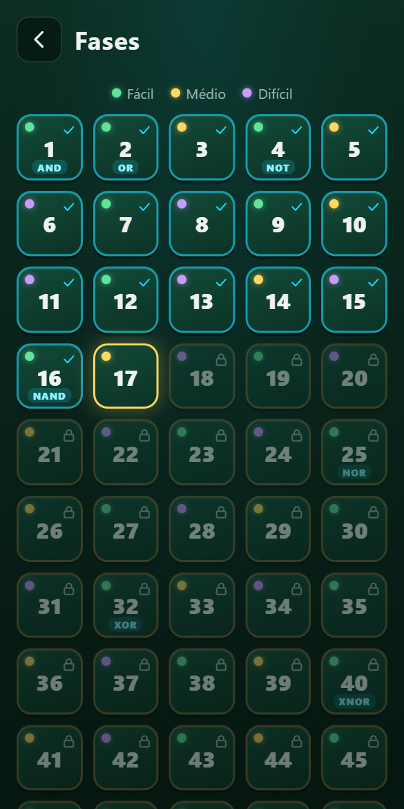
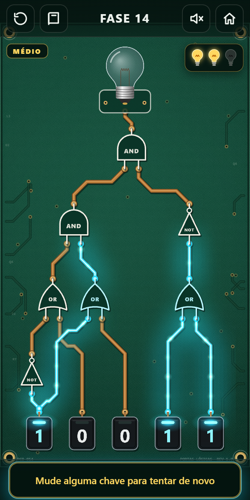
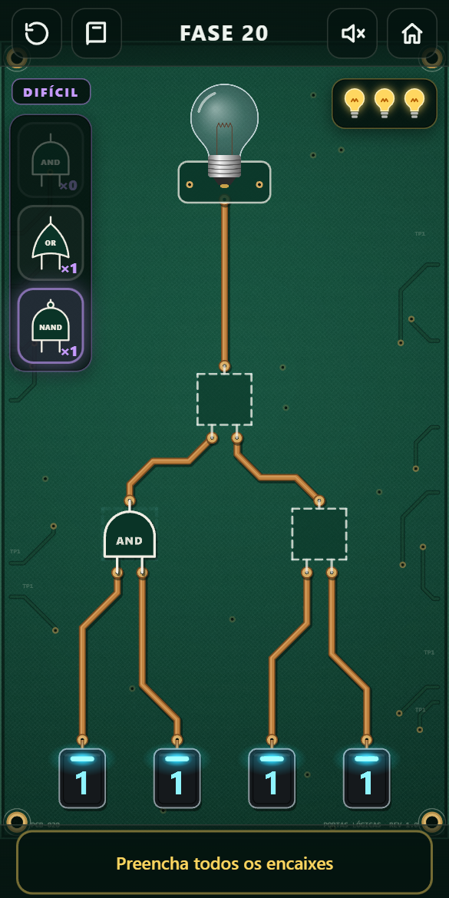

<div align="center">

# 💡 Portas Lógicas

**Aprenda como os computadores pensam acendendo uma lâmpada.**

Um jogo de navegador gratuito que ensina portas lógicas para quem está começando em computação, de qualquer idade.

[**▶ Jogar agora**](https://tclaro.github.io/logicGates/)


</div>

---

## 🎯 Objetivo didático

Toda decisão de um computador, de somar dois números a mostrar esta página, é feita por **portas lógicas**: circuitos minúsculos que recebem zeros e uns e devolvem zero ou um. Este jogo existe para que esse conceito deixe de ser abstrato.

Em vez de começar decorando tabelas, o aluno **mexe nas chaves, vê a energia percorrer as trilhas da placa e descobre a regra de cada porta pela experiência**. A tabela verdade aparece depois, como a confirmação do que ele já percebeu.

O jogo foi pensado para:

- **Iniciantes de qualquer idade:** de crianças curiosas a estudantes do primeiro semestre de computação.
- **Aula e estudo individual:** o professor pode projetar o jogo em sala; o aluno pode jogar sozinho no celular.
- **Aprender sem medo de errar:** nas fases fáceis a energia aparece em cada trilha, e a barra de energia dá 50% de cliques a mais que o necessário. Fim de jogo nunca faz voltar fases.
- **Desafiar quem já aprendeu:** as [fases médias](#-fases-médias) escondem a energia e cobram que o aluno preveja o resultado antes de testar.
- **Inverter o problema:** nas [fases difíceis](#-fases-difíceis) as chaves são fixas e o aluno escolhe as portas, montando o circuito que acende a lâmpada.

### O que o aluno aprende

| Ao final, o aluno consegue… | Como o jogo trabalha isso |
|---|---|
| Reconhecer os símbolos das 7 portas lógicas | Cada porta aparece desenhada no padrão usado em livros e diagramas, com o nome escrito dentro |
| Prever a saída de uma porta para quaisquer entradas | Tocar numa porta mostra a tabela verdade dela, com a linha atual destacada ao vivo |
| Raciocinar sobre circuitos com várias portas encadeadas | As fases crescem de 1 para 11 portas, com até 5 níveis de profundidade |
| Ler as notações usadas em matemática e programação | Cada porta é apresentada também como `A ∧ B`, `A && B`, `¬A`, `A ⊕ B`, `A ^ B`… |
| Pensar "de trás para frente", partindo do resultado desejado | Para acender a lâmpada, é preciso descobrir o que cada porta precisa receber |
| Simular um circuito de cabeça, sem tentativa e erro | Nas fases médias a energia fica escondida e cada palpite errado custa uma vida |
| Escolher a porta certa para cada função | Nas fases difíceis o aluno monta o circuito com as peças disponíveis |

## 🧭 Como funciona

1. **A lâmpada começa apagada.** O objetivo de toda fase é acendê-la.
2. **O aluno alterna as chaves** na parte de baixo da tela entre `0` e `1`. Nem todas começam desligadas: às vezes é preciso desligar uma chave para a luz acender.
3. **A energia corre pelas trilhas** da placa. Cada porta só reage quando o sinal chega nela, e assim o aluno vê o caminho que a informação percorre.
4. **Antes de cada porta nova**, uma tela apresenta o símbolo, uma analogia do dia a dia, uma mini demonstração interativa, a tabela verdade e as outras formas de escrever a porta.

<div align="center">

| Apresentação de uma porta nova | Tabela verdade ao tocar na porta | Fase concluída |
|:---:|:---:|:---:|
|  |  |  |

</div>

## 🎚️ Três dificuldades numa só sequência

O jogo tem uma única sequência de 51 fases. Cada fase tem uma dificuldade, indicada por um rótulo no canto superior esquerdo da placa e por uma bolinha colorida na tela de seleção:

| Dificuldade | O que muda |
|---|---|
| 🟢 **Fácil** | O circuito está pronto e a energia aparece em cada trilha enquanto o aluno mexe nas chaves; cada toque gasta a barra de energia |
| 🟡 **Médio** | O mesmo tipo de circuito, mas a energia fica escondida até o aluno tocar em Ativar |
| 🟣 **Difícil** | As chaves são fixas e o aluno monta o circuito levando as peças até os encaixes |

As dificuldades se alternam desde o começo, para que ninguém passe o jogo inteiro só no fácil. Portas novas são sempre apresentadas numa fase fácil.

### Vidas e fim de jogo

- **3 lâmpadas de vida** ficam no canto superior direito da placa, em todas as fases. Elas **passam de uma fase para a outra**: vencer uma fase não as renova.
- **Fase fácil:** embaixo das lâmpadas há uma **barra de energia** que diminui a cada toque numa chave. Ela começa com 50% a mais que o número mínimo de cliques da fase, arredondando para cima (mínimo 3 → 5 toques). Se a barra zerar sem a lâmpada acender, uma lâmpada de vida estoura e a barra enche de novo. Reiniciar a fase ou sair e voltar não enchem a barra.
- **Fases difíceis com energia visível** (as primeiras, sem botão Ativar): a mesma barra, gasta a cada peça encaixada. O mínimo de jogadas é o número de encaixes (1, 2 e 3 encaixes → 2, 3 e 5 jogadas). Devolver uma peça à bandeja não gasta.
- **Fases com energia escondida** (médias e as demais difíceis): cada ativação errada estoura uma lâmpada.
- **Fim de jogo:** quando a última lâmpada estoura, as 3 se renovam e o aluno **recomeça exatamente da fase em que estava**.
- Vidas e barra ficam salvas no aparelho: recarregar a página não as renova.

<div align="center">

| Seleção de fases | Fase média | Fase difícil |
|:---:|:---:|:---:|
|  |  |  |

</div>

## ⚡ Fases médias

Nas fases fáceis o aluno pode testar chaves até a lâmpada acender, vendo a energia em cada trilha. As médias tiram essa muleta: **a energia fica escondida e o aluno precisa simular o circuito de cabeça** antes de testar. É a forma de verificar se as portas foram realmente entendidas, e não só descobertas por tentativa.

1. **As trilhas ficam apagadas.** Mexer nas chaves não mostra nada: o aluno vê o desenho do circuito, mas não os valores.
2. **O aluno monta as chaves e toca em Ativar** (ou aperta `Enter`). Só então a energia corre pela placa, porta por porta.
3. **Se a lâmpada acender**, a fase está vencida.
4. **Se não acender**, uma das [lâmpadas de vida](#vidas-e-fim-de-jogo) queima. A energia continua visível, para o aluno entender onde errou. Para tentar de novo, ele muda alguma chave, o que apaga a placa outra vez, e toca em Ativar.

Tocar numa porta mostra a tabela verdade **sem** destacar a linha atual, porque isso revelaria os valores escondidos.

## 🧩 Fases difíceis

Nas outras fases o circuito está pronto e o aluno descobre as chaves. Nas difíceis é o contrário: **as chaves são fixas, a fiação também, e o aluno escolhe que porta vai em cada encaixe** para a lâmpada acender.

1. **A placa traz encaixes tracejados** no lugar de algumas portas. Os pinos de cada encaixe dizem quantas entradas ele tem: a NOT só cabe nos de um pino, as demais nos de dois.
2. **A bandeja na lateral esquerda mostra as peças disponíveis**, com a quantidade de cada uma. Ela se posiciona sozinha onde não cobre nenhuma parte do circuito. O aluno arrasta a peça até o encaixe, ou toca na peça e depois no encaixe. Tocar numa peça já encaixada a devolve à bandeja.
3. **Nas primeiras fases difíceis a energia é visível**: a lâmpada acende assim que o circuito montado está certo, e cada peça encaixada gasta a [barra de energia](#vidas-e-fim-de-jogo).
4. **Depois a energia fica escondida**, como nas médias: com todos os encaixes preenchidos o aluno toca em Ativar, e cada montagem errada queima uma lâmpada de vida. Para tentar de novo, ele troca alguma peça.
5. **Algumas fases têm uma chave com relógio**, que alterna sozinha entre 0 e 1 depois da ativação. A lâmpada precisa ficar acesa nos dois valores, ou seja, o circuito tem que funcionar qualquer que seja essa entrada.
6. **No fim de jogo**, as peças voltam para a bandeja e a fase recomeça com as 3 lâmpadas renovadas.

| Regra | Por quê |
|---|---|
| As peças são contadas | Restringe as escolhas e cria desafios como "use só estas portas" |
| Qualquer montagem certa vence a fase | O aluno é avaliado pelo comportamento do circuito, não por adivinhar a resposta gravada |
| No máximo uma chave com relógio por fase | Mantém a verificação curta: dois estados, alternados três vezes |

## 🪜 Progressão das fases

As portas são apresentadas uma de cada vez, sempre numa fase fácil. Depois de cada porta nova vêm fases que a misturam com as anteriores, alternando as três dificuldades.

| Fases | Porta nova | Sequência (F = fácil, M = médio, D = difícil) |
|:---:|---|---|
| 1–3 | **AND** (E) na 1, **OR** (OU) na 2 | F F M |
| 4–15 | **NOT** (NÃO) | F M D F D F M D F D M D |
| 16–24 | **NAND** | F M D F D M D F D |
| 25–31 | **NOR** | F M F D M F D |
| 32–39 | **XOR** (OU exclusivo) | F M D F M D F M |
| 40–51 | **XNOR** | F M D F M F M F M F M D |

A ordem fica em `src/levels/campaign.ts`. As fases fáceis e médias vêm de `src/levels/data/` e as difíceis de `src/levels/ultimate/`, cada uma usada uma única vez.

A dificuldade é verificada automaticamente: cada fase passa por um validador que confirma que ela tem solução, que nenhuma porta aparece antes de ser apresentada e calcula o **número mínimo de cliques** para resolvê-la.

## 👩‍🏫 Para professores

- **Sem cadastro, sem instalação:** basta abrir o link no navegador do computador, do tablet ou do celular.
- **Progresso salvo no próprio aparelho:** as fases são liberadas em sequência, e as já vencidas podem ser jogadas de novo. Quem jogou a versão com três modos separados continua de onde parou: cada fase conta como vencida se foi vencida no modo que corresponde à dificuldade dela.
- **Glossário sempre à mão:** o aluno pode rever a explicação de qualquer porta que já apareceu.
- **Som ajustável a qualquer momento:** durante a fase, o botão de alto-falante liga e desliga os efeitos e a música, e o botão da casinha volta ao menu principal.
- **Atalhos de teclado** para usar com projetor: teclas `1` a `8` alternam as chaves, `R` reinicia a fase, `Enter` ativa nas fases com energia escondida e `Esc` fecha a tabela verdade.
- **Editor de fases:** quem rodar o projeto localmente pode criar fases novas com um editor visual (veja abaixo).

---

## 🛠️ Para desenvolvedores

Feito com **TypeScript**, **Vite** e **PixiJS** (WebGL) para a placa animada, e HTML/CSS para as telas. Áudio com **Howler.js**.

```bash
npm install
```
```bash
npm run dev
```
```bash
npm test
```
```bash
npm run test:e2e
```
```bash
npm run build
```

- `npm run dev` abre o jogo em `http://localhost:5173`. Nesse modo, `?level=N` abre direto a fase N da sequência.
- `npm test` roda os testes de unidade: lógica, solver, validador, layout e propagação.
- `npm run test:e2e` roda os testes no navegador (usa o Chrome instalado) e joga as 51 fases.
- `npm run build` gera o site estático em `dist/`. Cada push no `master` publica no GitHub Pages automaticamente.

### Estrutura

| Pasta | Conteúdo |
|---|---|
| `src/core` | Portas, avaliação do circuito, solver e validador de fases |
| `src/levels/campaign.ts` | A sequência única: dificuldade e fase de origem de cada fase |
| `src/levels/data` | Fases com circuito pronto, usadas nas fáceis e médias (`NN.json`) |
| `src/levels/chapters.ts` | Ordem das portas nas fases de `data/`, usada pelo editor |
| `src/layout` | Layout automático em camadas e roteamento das trilhas em 0°, 45° e 90° |
| `src/render` | A placa: trilhas, brilho, portas, lâmpada, chaves e a propagação animada |
| `src/core/ultimate.ts` | Fases difíceis: encaixes, estoque de peças, chave com relógio, solver de montagens e validador |
| `src/levels/ultimate` | Fases de montagem, usadas nas difíceis (`NN.json`) |
| `src/ui` | Menu, seleção de fases, introduções, glossário, HUD, tabela verdade, rótulo da dificuldade, vidas, botão Ativar e bandeja de peças |
| `src/storage/progress.ts` | Progresso salvo no `localStorage`: fases concluídas, portas vistas e som, com a conversão do progresso da versão de três modos |
| `src/i18n/pt-BR.json` | Todos os textos do jogo, prontos para tradução |
| `editor/` | Editor visual de fases |

### Criando fases

Com `npm run dev` rodando, abra `http://localhost:5173/editor/`. O editor mostra a placa ao vivo, valida a fase enquanto você edita e salva direto em `src/levels/data/`. Arraste uma porta na prévia para fixar a posição horizontal dela.

Uma fase é um JSON simples:

```json
{
  "id": 7,
  "inputs": [{ "id": "a", "initial": 0 }, { "id": "b", "initial": 1 }],
  "gates": [
    { "id": "g1", "type": "NOT", "in": ["b"] },
    { "id": "g2", "type": "AND", "in": ["a", "g1"] }
  ],
  "output": "g2"
}
```

Uma fase nova só entra no jogo depois de ser colocada na sequência de `src/levels/campaign.ts`. Os testes garantem que toda fase:
- começa com a lâmpada apagada e tem solução;
- tem todas as chaves e portas ligadas à lâmpada;
- só usa portas já apresentadas;
- tem layout sem portas sobrepostas e sem trilhas atravessando portas.

#### Fases de montagem (difíceis)

Ficam em `src/levels/ultimate/`. O formato é o mesmo, com quatro campos a mais:

```json
{
  "id": 7,
  "inputs": [{ "id": "a", "initial": 0 }],
  "gates": [
    { "id": "g1", "type": "NOT", "in": ["a"] },
    { "id": "g2", "type": "OR", "in": ["a", "g1"] }
  ],
  "output": "g2",
  "slots": ["g1", "g2"],
  "pieces": { "NOT": 1, "AND": 1, "OR": 1 },
  "hidden": true,
  "clock": "a"
}
```

- `slots`: portas que começam vazias. O `type` gravado nelas é a solução de referência.
- `pieces`: quantas peças de cada porta a bandeja oferece.
- `hidden`: energia escondida até Ativar; cada montagem errada custa uma vida.
- `clock`: chave que alterna sozinha; exige `hidden`.

Os testes garantem que toda fase de montagem tem solução, que a solução de referência é válida, que a lâmpada não acende com os encaixes vazios, que há no máximo 2 montagens certas e que a fase que estreia uma peça exige essa peça em toda solução.

Para ver as estatísticas de dificuldade de cada fase, rode este comando:

```bash
LEVEL_REPORT=1 npx vitest run tests/unit/levels.test.ts --silent=false
```

### Arte e sons

Os sons e a música já estão incluídos; a arte da placa ainda é desenhada por código. Para personalizar, coloque arquivos com estes nomes nas pastas indicadas. Arquivos ausentes são substituídos por versões geradas por código, sem erro.

**`public/assets/sprites/`** (PNG com fundo transparente)

| Arquivo | Tamanho | Observação |
|---|---|---|
| `board.png` | 1024×1024 | Textura da placa, emendável |
| `lamp_off.png` / `lamp_on.png` | 512×512 | Mesmo enquadramento, com a rosca embaixo |
| `switch_0.png` / `switch_1.png` | 256×256 | Sem número: o jogo desenha o 0/1 por cima |

**`public/assets/audio/`** (MP3)

| Arquivo | Quando toca |
|---|---|
| `switch_on.mp3` / `switch_off.mp3` | Chave ligada / desligada |
| `energize.mp3` | Botão Ativar |
| `lamp_on.mp3` | Lâmpada acende (toda fase vencida) |
| `win.mp3` | Última fase concluída |
| `ui_click.mp3` | Botões das telas |
| `burn.mp3` | Uma lâmpada de vida queima |
| `game_over.mp3` | Fim de jogo |
| `music.mp3` | Música de fundo, em loop |


