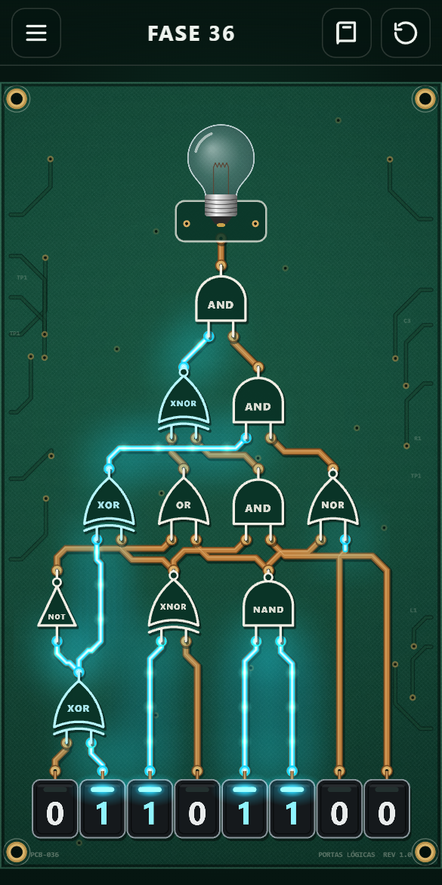
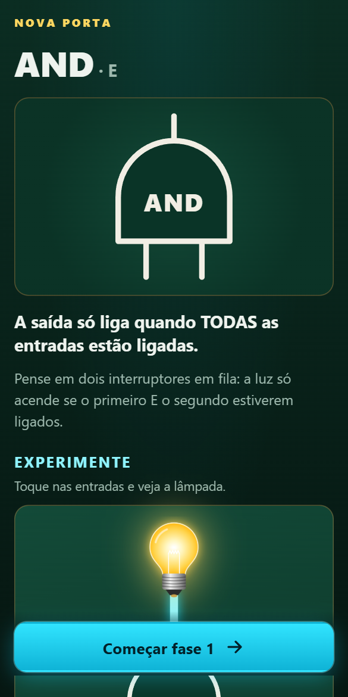
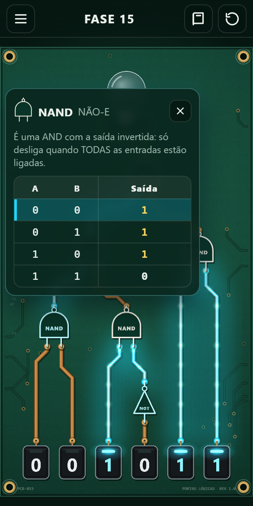
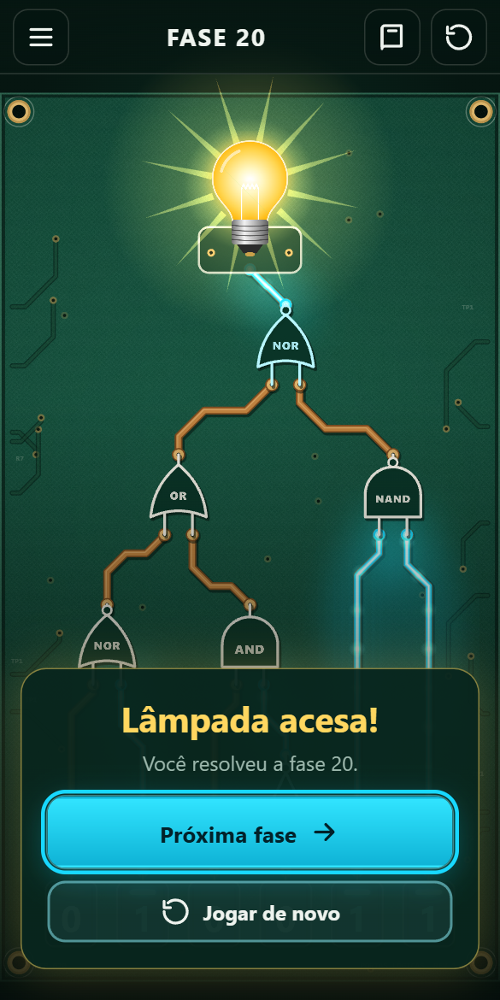

<div align="center">

# 💡 Portas Lógicas

**Aprenda como os computadores pensam acendendo uma lâmpada.**

Um jogo de navegador gratuito que ensina portas lógicas para quem está começando em computação, de qualquer idade.

[**▶ Jogar agora**](https://tclaro.github.io/logicGates/)




</div>

---

## 🎯 Objetivo didático

Toda decisão de um computador, de somar dois números a mostrar esta página, é feita por **portas lógicas**: circuitos minúsculos que recebem zeros e uns e devolvem zero ou um. Este jogo existe para que esse conceito deixe de ser abstrato.

Em vez de começar decorando tabelas, o aluno **mexe nas chaves, vê a energia percorrer as trilhas da placa e descobre a regra de cada porta pela experiência**. A tabela verdade aparece depois, como a confirmação do que ele já percebeu.

O jogo foi pensado para:

- **Iniciantes de qualquer idade:** de crianças curiosas a estudantes do primeiro semestre de computação.
- **Aula e estudo individual:** o professor pode projetar o jogo em sala; o aluno pode jogar sozinho no celular.
- **Aprender sem medo de errar:** não há pontuação, tempo nem vidas. Errar é só mudar uma chave de volta.

### O que o aluno aprende

| Ao final, o aluno consegue… | Como o jogo trabalha isso |
|---|---|
| Reconhecer os símbolos das 7 portas lógicas | Cada porta aparece desenhada no padrão usado em livros e diagramas, com o nome escrito dentro |
| Prever a saída de uma porta para quaisquer entradas | Tocar numa porta mostra a tabela verdade dela, com a linha atual destacada ao vivo |
| Raciocinar sobre circuitos com várias portas encadeadas | As fases crescem de 1 para 11 portas, com até 5 níveis de profundidade |
| Ler as notações usadas em matemática e programação | Cada porta é apresentada também como `A ∧ B`, `A && B`, `¬A`, `A ⊕ B`, `A ^ B`… |
| Pensar "de trás para frente", partindo do resultado desejado | Para acender a lâmpada, é preciso descobrir o que cada porta precisa receber |

## 🧭 Como funciona

1. **A lâmpada começa apagada.** O objetivo de toda fase é acendê-la.
2. **O aluno alterna as chaves** na parte de baixo da tela entre `0` e `1`. Nem todas começam desligadas: às vezes é preciso desligar uma chave para a luz acender.
3. **A energia corre pelas trilhas** da placa. Cada porta só reage quando o sinal chega nela, e assim o aluno vê o caminho que a informação percorre.
4. **Modo Expert:** depois de concluir a fase 10, o aluno pode jogar sem ver a energia. Ele monta as chaves, toca em **Ativar** e só então a energia corre. Cada erro queima uma das 3 lâmpadas de vida; perdendo as 3, volta ao início do capítulo. As fases seguem em sequência e as vidas se renovam a cada fase vencida.
5. **Antes de cada porta nova**, uma tela apresenta o símbolo, uma analogia do dia a dia, uma mini demonstração interativa, a tabela verdade e as outras formas de escrever a porta.

<div align="center">

| Apresentação de uma porta nova | Tabela verdade ao tocar na porta | Fase concluída |
|:---:|:---:|:---:|
|  |  |  |

</div>

## 🪜 Progressão das fases

As portas são apresentadas uma de cada vez. Depois de cada porta nova, vêm fases que a misturam com as anteriores.

| Fases | Conteúdo | Ideia central |
|:---:|---|---|
| 1 | **AND** (E) | Tudo precisa estar ligado |
| 2 | **OR** (OU) | Basta uma entrada ligada |
| 3–5 | AND + OR | Combinar condições |
| 6 | **NOT** (NÃO) | Inverter um sinal |
| 7–10 | AND, OR e NOT | Às vezes é preciso **desligar** para acender |
| 11 | **NAND** | A inversão de uma AND |
| 12–15 | Misturas com NAND | |
| 16 | **NOR** | A inversão de uma OR |
| 17–20 | Misturas com NOR | |
| 21 | **XOR** (OU exclusivo) | Entradas **diferentes** |
| 22–26 | Misturas com XOR | Um mesmo sinal alimentando várias portas |
| 27 | **XNOR** | Entradas **iguais** |
| 28–32 | Misturas com XNOR | |
| 33–36 | Desafios finais | Até 8 chaves, 11 portas e 5 níveis de profundidade |

A dificuldade é verificada automaticamente: cada fase passa por um validador que confirma que ela tem solução, que nenhuma porta aparece antes de ser apresentada e calcula o **número mínimo de cliques** para resolvê-la.

## 👩‍🏫 Para professores

- **Sem cadastro, sem instalação:** basta abrir o link no navegador do computador, do tablet ou do celular.
- **Progresso salvo no próprio aparelho:** as fases são liberadas em sequência, e as já vencidas podem ser jogadas de novo.
- **Glossário sempre à mão:** o aluno pode rever a explicação de qualquer porta que já apareceu.
- **Som ajustável a qualquer momento:** durante a fase, o botão de alto-falante liga e desliga os efeitos e a música, e o botão da casinha volta ao menu principal.
- **Modo Expert para revisão:** sem ver a energia, o aluno precisa prever o resultado do circuito antes de ativá-lo. É um bom teste depois que as portas já foram aprendidas.
- **Atalhos de teclado** para usar com projetor: teclas `1` a `8` alternam as chaves, `R` reinicia a fase, `Enter` ativa no modo Expert e `Esc` fecha a tabela verdade.
- **Editor de fases:** quem rodar o projeto localmente pode criar fases novas com um editor visual (veja abaixo).

---

## 🛠️ Para desenvolvedores

Feito com **TypeScript**, **Vite** e **PixiJS** (WebGL) para a placa animada, e HTML/CSS para as telas. Áudio com **Howler.js**.

```bash
npm install
```
```bash
npm run dev
```
```bash
npm test
```
```bash
npm run test:e2e
```
```bash
npm run build
```

- `npm run dev` abre o jogo em `http://localhost:5173`. Nesse modo, `?level=N` abre uma fase direto.
- `npm test` roda os testes de unidade: lógica, solver, validador, layout e propagação.
- `npm run test:e2e` roda os testes no navegador (usa o Chrome instalado) e joga as 36 fases.
- `npm run build` gera o site estático em `dist/`. Cada push no `master` publica no GitHub Pages automaticamente.

### Estrutura

| Pasta | Conteúdo |
|---|---|
| `src/core` | Portas, avaliação do circuito, solver e validador de fases |
| `src/levels/data` | Uma fase por arquivo (`NN.json`) |
| `src/levels/chapters.ts` | Em que fase cada porta é apresentada |
| `src/layout` | Layout automático em camadas e roteamento das trilhas em 0°, 45° e 90° |
| `src/render` | A placa: trilhas, brilho, portas, lâmpada, chaves e a propagação animada |
| `src/ui` | Menu, seleção de fases, introduções, glossário, HUD e tabela verdade |
| `src/i18n/pt-BR.json` | Todos os textos do jogo, prontos para tradução |
| `editor/` | Editor visual de fases |

### Criando fases

Com `npm run dev` rodando, abra `http://localhost:5173/editor/`. O editor mostra a placa ao vivo, valida a fase enquanto você edita e salva direto em `src/levels/data/`. Arraste uma porta na prévia para fixar a posição horizontal dela.

Uma fase é um JSON simples:

```json
{
  "id": 7,
  "inputs": [{ "id": "a", "initial": 0 }, { "id": "b", "initial": 1 }],
  "gates": [
    { "id": "g1", "type": "NOT", "in": ["b"] },
    { "id": "g2", "type": "AND", "in": ["a", "g1"] }
  ],
  "output": "g2"
}
```

Os testes garantem que toda fase:
- começa com a lâmpada apagada e tem solução;
- tem todas as chaves e portas ligadas à lâmpada;
- só usa portas já apresentadas;
- tem layout sem portas sobrepostas e sem trilhas atravessando portas.

Para ver as estatísticas de dificuldade de cada fase, rode este comando:

```bash
LEVEL_REPORT=1 npx vitest run tests/unit/levels.test.ts --silent=false
```

### Arte e sons

O jogo funciona com arte e sons provisórios gerados por código. Para personalizar, coloque arquivos com estes nomes nas pastas indicadas:

**`public/assets/sprites/`** (PNG com fundo transparente)

| Arquivo | Tamanho | Observação |
|---|---|---|
| `board.png` | 1024×1024 | Textura da placa, emendável |
| `lamp_off.png` / `lamp_on.png` | 512×512 | Mesmo enquadramento, com a rosca embaixo |
| `switch_0.png` / `switch_1.png` | 256×256 | Sem número: o jogo desenha o 0/1 por cima |

**`public/assets/audio/`** (MP3)

| Arquivo | Quando toca |
|---|---|
| `switch_on.mp3` / `switch_off.mp3` | Chave ligada / desligada |
| `energize.mp3` | Modo Expert: botão Ativar |
| `lamp_on.mp3` | Lâmpada acende |
| `win.mp3` | Fase concluída |
| `ui_click.mp3` | Botões das telas |
| `burn.mp3` | Modo Expert: uma lâmpada de vida queima |
| `game_over.mp3` | Modo Expert: fim de jogo |
| `music.mp3` | Música de fundo, em loop |
